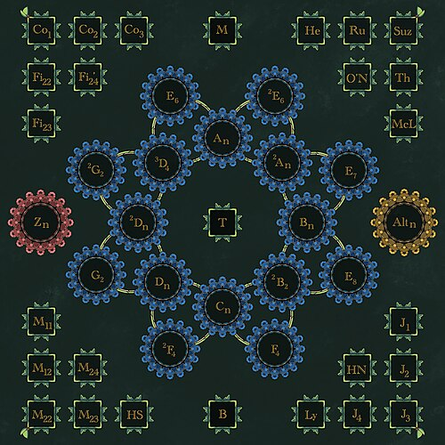

## Class Session Goals

By the end of this session, you should be able to:

- Define a simple group and identify examples and nonexamples.
- Prove that $\mathbb{Z}_p$ is simple when $p$ is prime.
- Describe the classification of finite simple groups and its historical significance.

---

## Motivation for Normal Subgroups

Cosets of a group are a set, and they inherit a multiplication from the group.  A natural questions is:  "Is the set of cosets a group?"  What do we need to make that happen.

What do we need to make multiplication work on the set of cosets?

We would like to define $(aH)(bH)=abH$.

The product must be well-defined because there a multiple representatives for each coset. We also need associativity, the identity and inverses.

---

## Definition of Normal Subgroup

A subgroup $H$ of a group $G$ is **normal** in $G$ if $gH=Hg$ for all $g\in G$.

For each $g$, the left coset $gH$ and the right coset $Hg$ must be equal.  Another way to say this conditions is that given $g \in G$ there are elements $h$ and $h'$ in $H$ such that $gh=h'g$.

---

## Left and Right Cosets in an Abelian Group

Let $G$ be abelian and let $H$ be a subgroup of $G$.

For every $g\in G$ and $h\in H$, we have $gh=hg$. Hence,

$gH=\{gh:h\in H\}=\{hg:h\in H\}=Hg$.

Every subgroup of an abelian group is normal.

---

## Subgroups of index 2

Homework problem from chapter 6 asked you to prove:

**Claim**:  The left and right cosets of a subgroup of index two are equal.

Left Cosets: $H$, $gH$

Right Coset: $H$, $Hg$

This shows that all subgoups of index 2 are normal.

---

## Theorem 10.1.3

Let $G$ be a group and $N$ be a subgroup of $G$. Then the following statements are equivalent.

1. The subgroup $N$ is normal in $G$.

2. For all $g\in G$, $gNg^{-1}\subset N$.

3. For all $g\in G$, $gNg^{-1}=N$.

---

## Proof of 10.1.3 {.smaller}
First implies second: Normality gives $gN=Ng$. For $g\in G$ and $n\in N$, write $gn=n'g$ with $n'\in N$. Then $gng^{-1}=n'\in N$, so $gNg^{-1}\subset N$.

Second implies Third: Fix $g\in G$. We already have $gNg^{-1}\subset N$. For $n\in N$, apply (2) to $g^{-1}$:

$g^{-1}ng=g^{-1}n(g^{-1})^{-1}\in N$.

Writing $n'=g^{-1}ng$ gives $n=gn'g^{-1}\in gNg^{-1}$. Thus $N\subset gNg^{-1}$, establishing equality.

Third implies first: If $gNg^{-1}=N$, then for each $n\in N$, $gng^{-1}=n'$ for some $n'\in N$. Hence $gn=n'g$, giving $gN\subset Ng$.

Applying (3) to $g^{-1}$ also gives $g^{-1}ng\in N$, so $ng=g(g^{-1}ng)\in gN$. Therefore $Ng\subset gN$.

Consequently, $gN=Ng$ for every $g\in G$, and $N$ is normal in $G$. 

---

## Factor Groups

Let $N$ be normal in $G$.

The **factor group**, or **quotient group**, is the set of cosets

$G/N=\{gN:g\in G\}$,

with multiplication defined by

$(aN)(bN)=abN$.

The elements of $G/N$ are cosets, each of which is a set of elements of $G$.

---

## Theorem 10.1.4

Let $N$ be a normal subgroup of a group $G$. The cosets of $N$ in $G$ form a group $G/N$ of order $[G:N]$.

The operation is $(aN)(bN)=abN$.

What do we need to show?

- Identity: $eN=N$.
- Inverse of $gN$: $g^{-1}N$.
- Order: the number of distinct cosets of $N$ in $G$.

---

## Proof 10.1.4

**Well-defined:** Suppose $aN=bN$ and $cN=dN$.

Write $a=bn_1$ and $c=dn_2$, where $n_1,n_2\in N$. Then

$$
acN=bn_1dn_2N=bn_1dN=bn_1Nd=bNd=bdN.
$$

Here $dN=Nd$ because $N$ is normal.

**Associativity:** $((aN)(bN))(cN)=(ab)cN=a(bc)N=(aN)((bN)(cN))$.

**Identity:** $(eN)(gN)=gN=(gN)(eN)$.

**Inverses:** $(gN)(g^{-1}N)=N=(g^{-1}N)(gN)$.

Finally, $|G/N|=[G:N]$. $\square$

---

## Example 1

Take $N=\{(1),(1\,2\,3),(1\,3\,2)\}=A_3$ in $S_3$.

The two cosets are $N$ and $(1\,2)N$.

| $\cdot$ | $N$ | $(1\,2)N$ |
|:---|:---:|:---:|
| $N$ | $N$ | $(1\,2)N$ |
| $(1\,2)N$ | $(1\,2)N$ | $N$ |

Thus $S_3/N\cong\mathbb{Z}_2$.

---

## Example 2 {.smaller}

The subgroup $3\mathbb{Z}$ is normal in $\mathbb{Z}$. Its cosets are

- $0+3\mathbb{Z}=\{\ldots,-3,0,3,6,\ldots\}$.
- $1+3\mathbb{Z}=\{\ldots,-2,1,4,7,\ldots\}$.
- $2+3\mathbb{Z}=\{\ldots,-1,2,5,8,\ldots\}$.

| $+$ | $0+3\mathbb{Z}$ | $1+3\mathbb{Z}$ | $2+3\mathbb{Z}$ |
|:---|:---:|:---:|:---:|
| $0+3\mathbb{Z}$ | $0+3\mathbb{Z}$ | $1+3\mathbb{Z}$ | $2+3\mathbb{Z}$ |
| $1+3\mathbb{Z}$ | $1+3\mathbb{Z}$ | $2+3\mathbb{Z}$ | $0+3\mathbb{Z}$ |
| $2+3\mathbb{Z}$ | $2+3\mathbb{Z}$ | $0+3\mathbb{Z}$ | $1+3\mathbb{Z}$ |

In general, $(k+n\mathbb{Z})+(l+n\mathbb{Z})=k+l+n\mathbb{Z}$.

---

## Example 3

The dihedral group $D_n$ has generators $r$ and $s$ satisfying

$r^n=\mathrm{id}$, $\quad s^2=\mathrm{id}$, $\quad srs=r^{-1}$.

The rotations form the cyclic subgroup $R_n=\langle r\rangle$.

Conjugation by $r$ preserves $R_n$, and
$srs^{-1}=srs=r^{-1}\in R_n$.

Thus $R_n$ is normal in $D_n$.

There are two cosets: $R_n$ and $sR_n$. Therefore,

$D_n/R_n\cong\mathbb{Z}_2$.

---

## Definition of Simple Groups

A nontrivial group $G$ is **simple** if its only normal subgroups are $\{e\}$ and $G$.

Thus, if $N$ is normal in $G$, then

$N=\{e\}$ or $N=G$.

A simple group may have proper nontrivial subgroups; none of them can be normal.

---

## Example: $\mathbb{Z}_p$

Let $p$ be prime.

If $H$ is a subgroup of $\mathbb{Z}_p$, Lagrange's Theorem gives $|H|\mid p$.

Therefore, $|H|=1$ or $|H|=p$, so

$H=\{0\}$ or $H=\mathbb{Z}_p$.

Consequently, $\mathbb{Z}_p$ is simple.

**More generally:** A finite cyclic group is simple if and only if its order is prime.

---

## Other Noteworthy Examples 

- **Alternating groups:** $A_n$ is simple for $n\geq 5$.
- **Projective special linear groups:** $\mathrm{PSL}_2(\mathbb{F}_5)\cong A_5$ is simple.
- **Mathieu groups:** $M_{11},M_{12},M_{22},M_{23},M_{24}$ are sporadic simple groups.
- **Conway groups:** $\mathrm{Co}_1,\mathrm{Co}_2,\mathrm{Co}_3$ are sporadic simple groups.
- **The Monster:** $\mathbb{M}$ is the largest sporadic simple group, with order approximately $8.08\times 10^{53}$.

---

## Historical Notes: The Enormous Theorem

**Classification of Finite Simple Groups**

Every finite simple group is isomorphic to one of the following:

1. A cyclic group $\mathbb{Z}_p$, where $p$ is prime.
2. An alternating group $A_n$, where $n\geq 5$.
3. A finite simple group of Lie type.
4. One of the $26$ sporadic simple groups.

The theorem gives a complete list, up to isomorphism.

---

## Historical Notes: The Enormous Theorem

- The original classification involved roughly $100$ mathematicians, about $500$ papers, and approximately $10{,}000$ pages.  
- Works started in 1832 and was completed in 2004, most work was completed by $1983$.
- Every finite group has a composition series whose factors are simple.
- Simple groups are the “building blocks” of finite groups.

---

## All Known Simple Groups

{fig-alt="Classification of the finite simple groups" fig-align="center" height="550px"}

---

## Lemma 10.2.1

The alternating group $A_n$ is generated by $3$-cycles for $n\geq 3$.

---

## Proof of 10.2.1

An even permutation is a product of pairs of transpositions.

Each pair can be rewritten using $3$-cycles:

$$
\begin{aligned}
(a,b)(a,b)&=\mathrm{id},\\
(a,b)(c,d)&=(a,c,b)(a,c,d),\\
(a,b)(a,c)&=(a,c,b).
\end{aligned}
$$

These cover identical, disjoint, and overlapping transpositions.

Every $3$-cycle is even, so the $3$-cycles generate exactly $A_n$. $\square$

---

## Lemma 10.2.2

Let $N$ be a normal subgroup of $A_n$, where $n\geq 3$.

If $N$ contains a $3$-cycle, then $N=A_n$.

---

## Proof of 10.2.2 {.smaller}

**Step 1: Fix two symbols $i$ and $j$.**

The cycles $(i,j,k)$ generate all $3$-cycles, using

$$
\begin{aligned}
(i,a,j)&=(i,j,a)^2,\\
(i,a,b)&=(i,j,b)(i,j,a)^2,\\
(j,a,b)&=(i,j,b)^2(i,j,a),\\
(a,b,c)&=(i,j,a)^2(i,j,c)(i,j,b)^2(i,j,a).
\end{aligned}
$$

Here the symbols in each identity are distinct.

By Lemma 10.2.1, these cycles therefore generate $A_n$.

---

## Proof of 10.2.2: Continued

**Step 2: Use normality.**

Suppose $(i,j,a)\in N$. Its inverse $(i,j,a)^2$ also belongs to $N$.

For $k\notin\{i,j,a\}$, let $\rho=(i,j)(a,k)\in A_n$.

Normality gives

$\rho(i,j,a)^2\rho^{-1}=(i,j,k)\in N$.

Thus $N$ contains every generator $(i,j,k)$ with $k\neq i,j$, including the original $(i,j,a)$.

Therefore, $N=A_n$. $\square$

---

## Lemma 10.2.3

For $n\geq 5$, every nontrivial normal subgroup $N$ of $A_n$ contains a $3$-cycle.

---

## Proof of 10.2.3: Setup

Choose $\sigma\in N$ with $\sigma\neq\mathrm{id}$.

For any $\alpha\in A_n$, normality gives

$\alpha\sigma\alpha^{-1}\in N$,

and hence

$\sigma^{-1}\alpha\sigma\alpha^{-1}\in N$.

We use this construction to obtain simpler cycle structures.

In the following cases, $\tau$ denotes the product of the remaining disjoint cycles.

---

## Proof of 10.2.3: Long Cycles

**Case 1:** $\sigma$ contains a cycle of length $r>3$.

Write $\sigma=\tau(a_1,a_2,\ldots,a_r)$ and take $\alpha=(a_1,a_2,a_3)$.

Then

$$
\begin{aligned}
\sigma^{-1}\alpha\sigma\alpha^{-1}
&=(a_r,a_1,a_2)(a_1,a_3,a_2)\\
&=(a_1,a_3,a_r)\in N.
\end{aligned}
$$

Thus $N$ contains a $3$-cycle.

---

## Proof of 10.2.3: Two $3$-Cycles

**Case 2:** $\sigma=\tau(a_1,a_2,a_3)(a_4,a_5,a_6)$.

Take $\alpha=(a_1,a_2,a_4)$. Then

$$
\begin{aligned}
\sigma^{-1}\alpha\sigma\alpha^{-1}
&=(a_3,a_1,a_6)(a_1,a_4,a_2)\\
&=(a_1,a_4,a_2,a_6,a_3)\in N.
\end{aligned}
$$

This is a $5$-cycle.

Case 1 now produces a $3$-cycle in $N$.

---

## Proof of 10.2.3: One $3$-Cycle

**Case 3:** $\sigma=\tau(a_1,a_2,a_3)$, where $\tau$ consists of disjoint $2$-cycles.

Because $\tau^2=\mathrm{id}$ and the cycles are disjoint,

$\sigma^2=\tau^2(a_1,a_2,a_3)^2=(a_1,a_3,a_2)\in N$.

Thus $N$ contains a $3$-cycle.

This includes the case where $\sigma$ itself is a $3$-cycle.

---

## Proof of 10.2.3: Only $2$-Cycles {.smaller}

**Case 4:** $\sigma=\tau(a_1,a_2)(a_3,a_4)$, where $\tau$ consists of an even number of disjoint $2$-cycles.

Take $\alpha=(a_1,a_2,a_3)$. Then

$\delta=\sigma^{-1}\alpha\sigma\alpha^{-1}=(a_1,a_3)(a_2,a_4)\in N$.

Since $n\geq 5$, choose $b\notin\{a_1,a_2,a_3,a_4\}$ and put $\mu=(a_1,a_3,b)$.

Normality gives

$\mu^{-1}\delta\mu\delta=(a_1,a_3,b)\in N$.

Every possible nonidentity cycle structure has now been covered. Thus $N$ contains a $3$-cycle. $\square$

---

## Theorem 10.2.4

The alternating group, $A_n$, is simple for $n\geq 5$.

---

## Proof of 10.2.4

Let $N$ be a **nontrivial** normal subgroup of $A_n$, where $n\geq 5$.

By Lemma 10.2.3, $N$ contains a $3$-cycle.

By Lemma 10.2.2, $N=A_n$.

Therefore, the only normal subgroups of $A_n$ are $\{\mathrm{id}\}$ and $A_n$.

Hence $A_n$ is simple. $\square$

---